# What drives tenant satisfaction in social housing?

A Python analysis of the Regulator of Social Housing's Tenant Satisfaction Measures (TSMs) for England's large social landlords, combined with Statistical Data Return stock data and the English Indices of Deprivation 2025.

It works through a series of questions about the whole sector: which operational measures go with satisfaction, how much of the difference between landlords they explain, what else might explain the rest, how things changed over a year, whether machine learning does better than a simple model, and which parts of the service matter most to tenants.

## Summary

- **Escalated complaints are the operational measure most strongly linked to low satisfaction**, followed by repairs completed on time. A regression on four operational measures, allowing for survey method, size and region, explains almost 60% of the differences between housing associations.
- **How the survey is run matters.** Landlords surveying mainly by post score about 10 points higher than those surveying online, and landlords whose own staff did the interviews score about 4 points higher than predicted. Comparisons between landlords need to be like for like.
- **Area deprivation, survey company and stock profile add nothing** once operations are allowed for. Of everything tested from the public data, only the staff interviewing flag improves predictions.
- **Machine learning doesn't beat the simple regression.** A random forest and gradient boosting predict unseen landlords less well, though both confirm escalated complaints as the key operational measure.
- **Home maintenance, being listened to and fair treatment are the strongest drivers of overall satisfaction** among the 11 specific survey measures. **Being listened to is the sector's clearest opportunity**: it's the second most important driver, yet only 65.5% of tenants are satisfied with it at a typical landlord. Complaints handling has the most room to improve of all (a median of 38.7%).

## Contents

1. [What goes with satisfaction across the sector?](#1-what-goes-with-satisfaction-across-the-sector)
2. [How well does a simple model explain it?](#2-how-well-does-a-simple-model-explain-it)
3. [What else might explain the differences?](#3-what-else-might-explain-the-differences)
4. [How did things change year on year?](#4-how-did-things-change-year-on-year)
5. [Does machine learning do better?](#5-does-machine-learning-do-better)
6. [What matters most to tenants?](#6-what-matters-most-to-tenants)
7. [Conclusions](#7-conclusions)
8. [Notebooks](#notebooks), [method](#method), [limitations](#limitations), [data and how to run](#data-and-how-to-run)

---

## 1. What goes with satisfaction across the sector?

*Notebooks [01](notebooks/01_load_and_explore.ipynb) and [02](notebooks/02_join_and_explore.ipynb)*

- The data covers **353 landlords** (195 housing associations and 158 councils). **Listens and acts** varies most between landlords, and **complaints handling** has by far the lowest scores (a median of 35.5%).
- **Stage 2 complaints** (complaints escalated after an unhappy first response) per 1,000 homes has the strongest link with low overall satisfaction across 195 housing associations (Spearman correlation −0.65). **Repairs completed on time** goes with higher satisfaction, especially satisfaction with repair time (+0.39).
- **How the survey is run matters.** Landlords surveying mainly by post have a median overall satisfaction of 77.6%, against 67.9% online, so every comparison is made like with like.

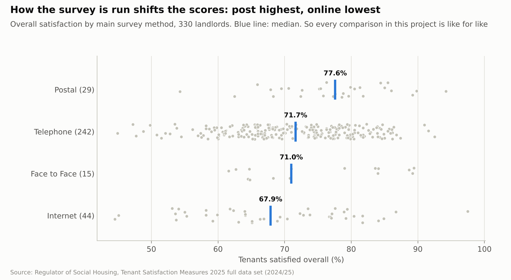

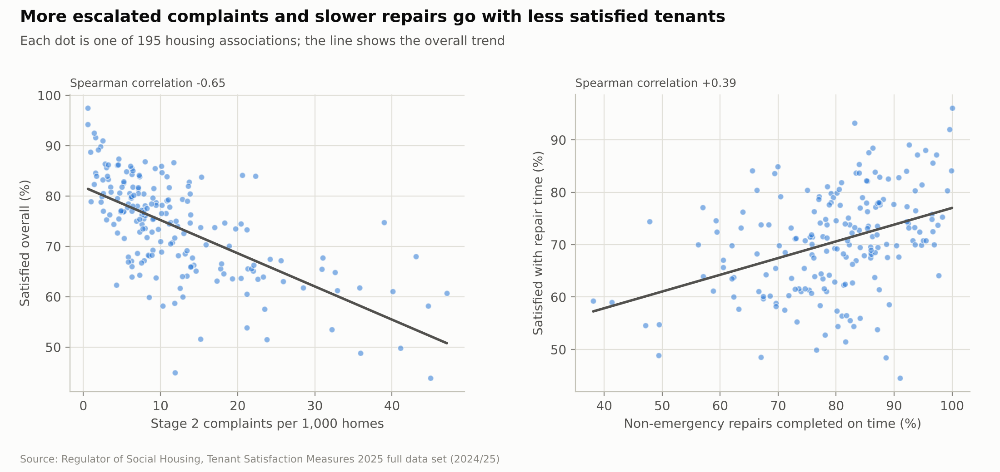

## 2. How well does a simple model explain it?

*Notebooks [03](notebooks/03_regression_model.ipynb) and [04](notebooks/04_charts.ipynb)*

- **A multiple regression explains almost 60% of the variation** in overall satisfaction (R² 0.59). Context alone (survey method, size, region) explains about a third. On landlords the model hasn't seen, it scores 0.42 on a single cross-validation split, and 0.49 averaged over 50 splits (notebook 8), against 0.17 for context alone.
- **Moving from a typical low performer to a typical high performer** (25th to 75th percentile) goes with about 3.9 points of satisfaction on stage 2 complaints and 2.3 points on repairs on time.
- **The model predicts 57% of housing associations to within 5 points.** The rest, above or below, are where something beyond the operational measures is going on. Gaps are noisier for small landlords, whose survey samples are smaller.

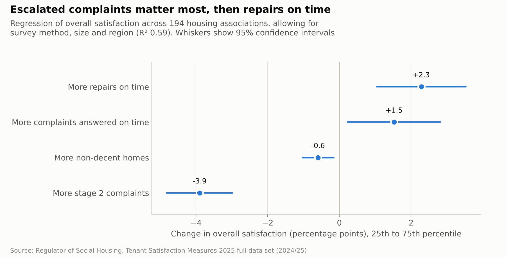

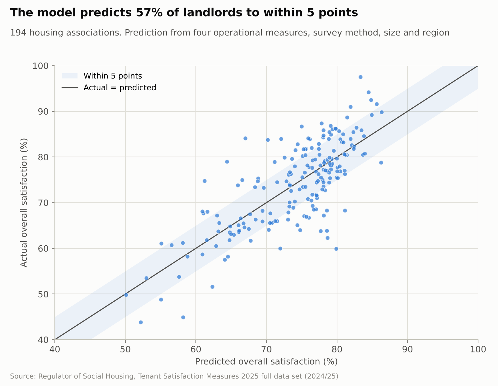

## 3. What else might explain the differences?

*Notebooks [05](notebooks/05_deprivation.ipynb) and [06](notebooks/06_survey_and_stock_checks.ipynb)*

Five possible explanations were tested by adding each to the regression and checking whether it improves predictions for unseen landlords.

| Explanation | Test | Result |
| --- | --- | --- |
| **Sampling error** | Funnel plot of 148 telephone-survey housing associations | 74% sit outside the 99.8% limits, against 0.2% by chance. The differences between landlords are real |
| **Area deprivation** | Stock-weighted deprivation score from SDR stock by local authority and the Indices of Deprivation 2025 | Barely linked to satisfaction (Spearman +0.02). No domain has a clear effect in the model |
| **Survey company** | Residuals grouped by survey company | No company's clients sit clearly above or below their predictions |
| **Who did the interviews** | Landlord's own staff against an external company | About 3.9 points higher than predicted (95% CI +0.3 to +7.4; 26 landlords). The only explanation that improves predictions |
| **Stock profile** | Older people's and supported housing, building age, houses versus flats, energy ratings (SDR File 03) | Adds nothing once operations are allowed for, and makes predictions worse |

The staff interviewing result is consistent with tenants answering more positively to their landlord's own staff. That's worth bearing in mind when comparing any landlord's TSMs.

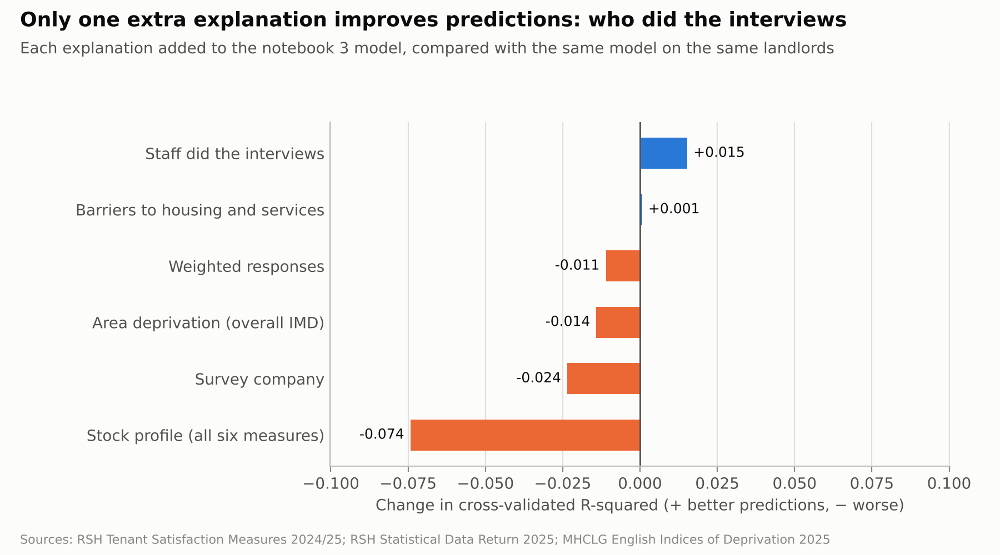

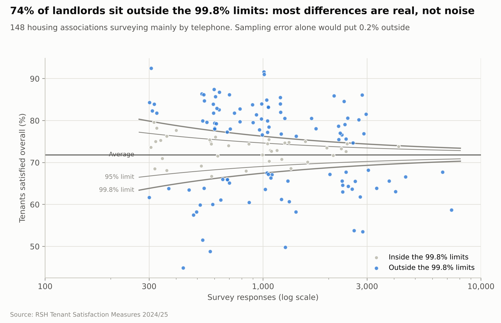

More charts: deprivation and survey company

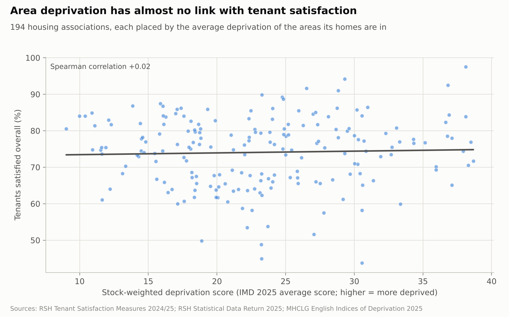

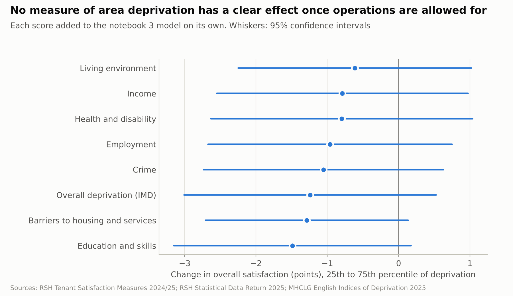

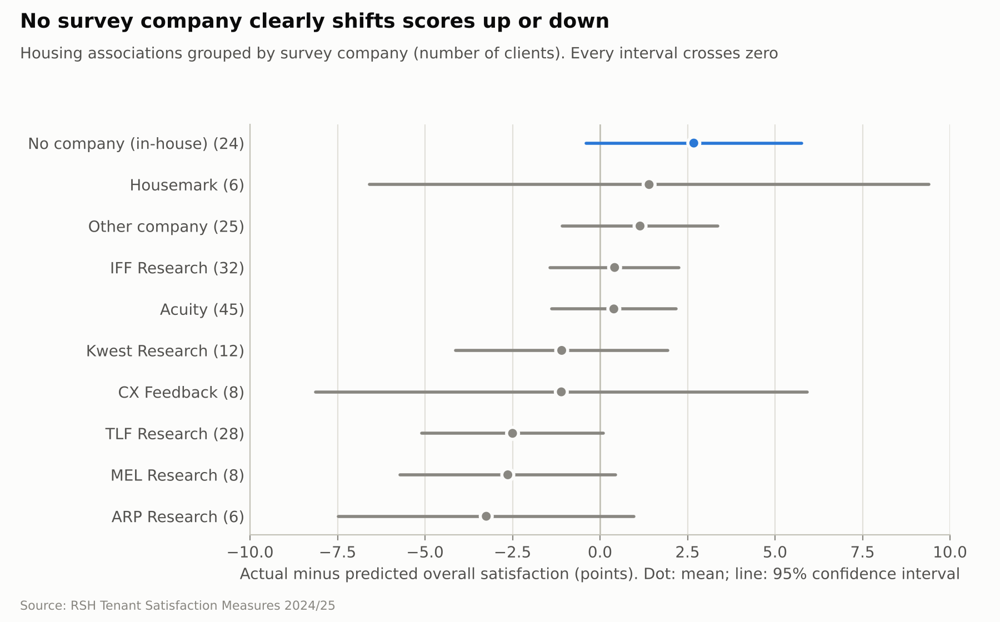

## 4. How did things change year on year?

*Notebook [07](notebooks/07_year_on_year.ipynb), 192 housing associations in both 2023/24 and 2024/25*

- **Satisfaction is very stable** (correlation 0.91 between years) and rose slightly on all 12 measures (median +1.3 points overall, +2.1 for complaints handling).
- **Regression to the mean is sizeable.** A landlord starting at 60% would be expected to rise about 3 points, and one at 90% to fall about 1, with no change in service. Year-on-year comparisons need to allow for it.
- **Comparing each landlord with itself, only repairs on time has a consistent link with satisfaction** (about +0.07 points per point of repairs on time, in the same direction as the single-year model but about half the size). Changes in complaint volumes show no consistent link, possibly because the Complaint Handling Code became statutory on 1 April 2024 and changed what landlords record.

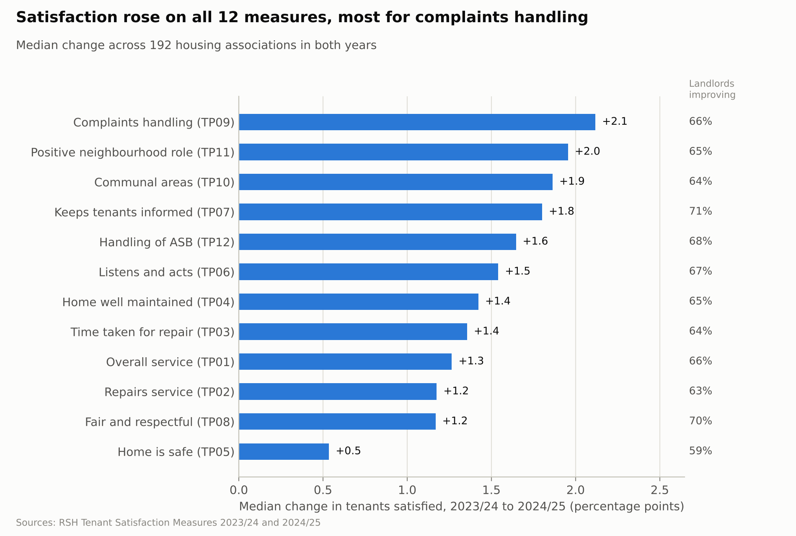

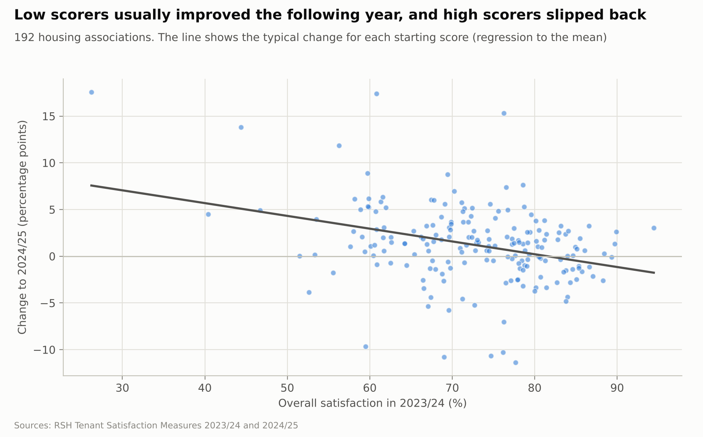

More charts: single-year against change model

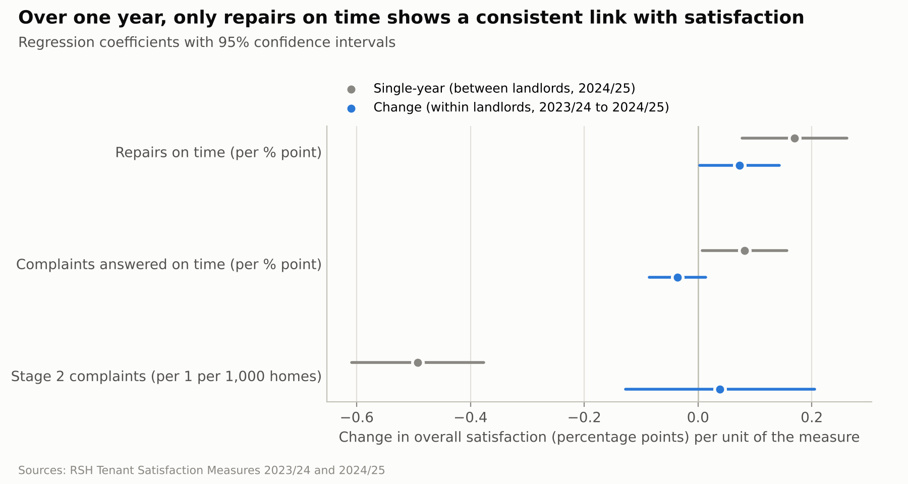

## 5. Does machine learning do better?

*Notebook [08](notebooks/08_machine_learning.ipynb)*

- **No: the simple regression wins.** With 5-fold cross-validation repeated 10 times, the four-input regression scores R² 0.49 on unseen landlords, against 0.43 for a random forest and gradient boosting. All beat a baseline that always predicts the average (mean absolute error 5.3 points against 7.8). With under 200 landlords, extra flexibility mostly fits noise.
- **The random forest independently confirms the main finding**: stage 2 complaints carries almost all its predictive power. Its partial dependence curves hint that repairs on time matters most above about 80%.
- **Bottom-quartile satisfaction can be flagged well** from operational data (cross-validated AUC about 0.85). **But the classifier misses about half of them (23 of 49)**: landlords whose repairs and complaints figures look fairly ordinary, so their satisfaction problem isn't visible in the operational data.

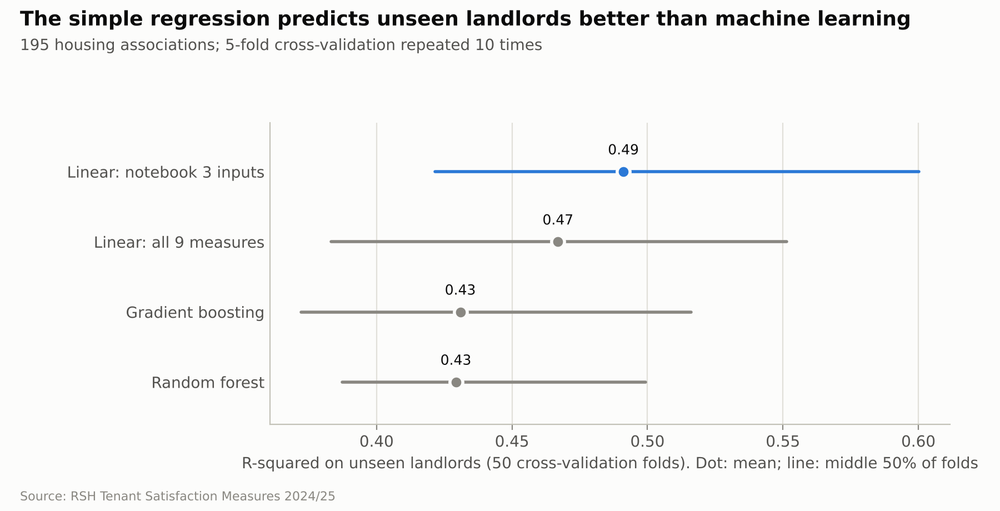

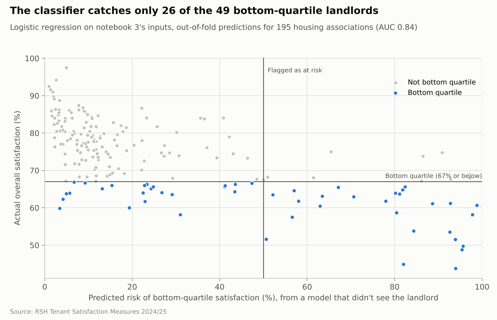

More charts: feature importance and partial dependence

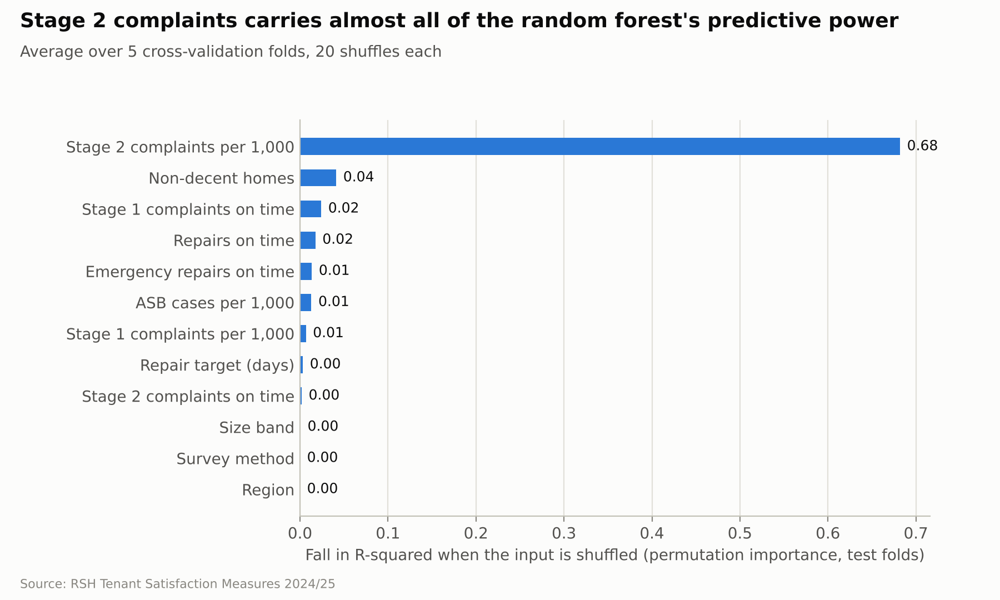

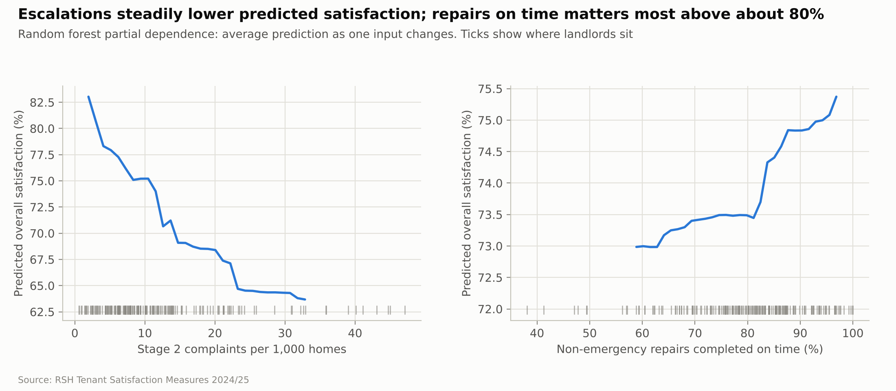

## 6. What matters most to tenants?

*Notebook [09](notebooks/09_key_drivers.ipynb)*

- The 11 specific survey measures explain 95% of the variation in overall satisfaction between housing associations, but overlap so heavily (VIFs up to 26) that an ordinary regression gives some of them negative effects. **Dominance analysis** (the Shapley-value approach) splits the explained variation fairly.
- **Home well maintained (12.9%), listens and acts (12.4%) and fair and respectful (11.4%)** are the strongest drivers. The top two rank in the top three in all 200 bootstrap resamples.
- **Combining importance with how the sector scores, being listened to is the clearest opportunity**: it's important, and the sector median is only 65.5%. Complaints handling has the most room to improve (38.7%). Home well maintained is the most important driver but already scores fairly well (74.7%).

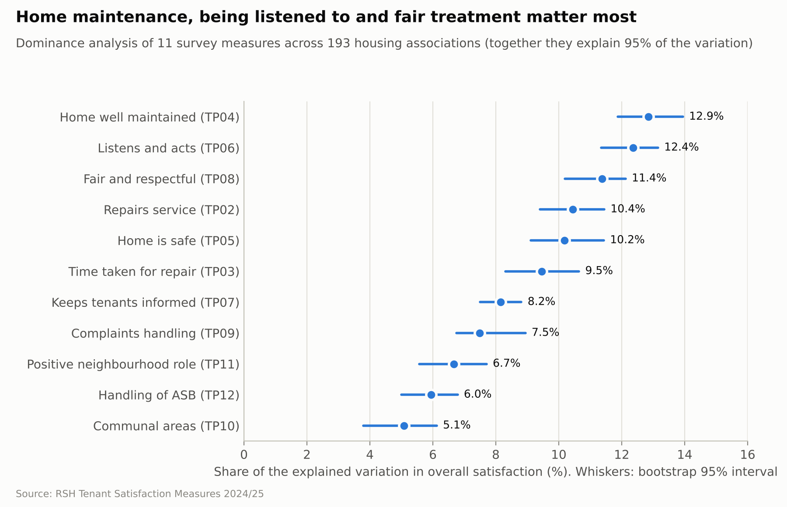

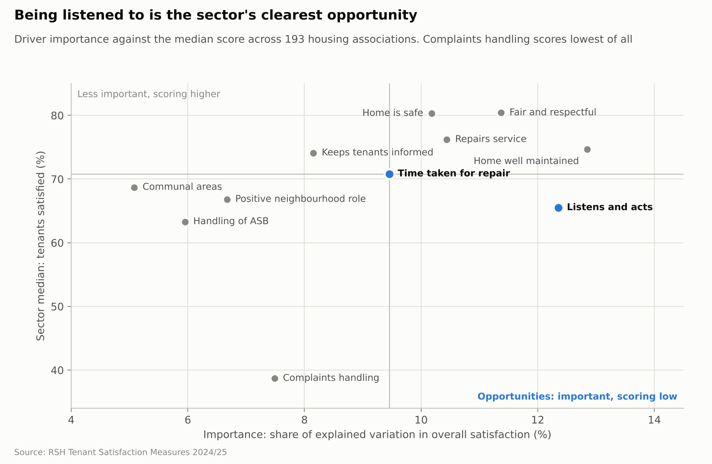

## 7. Conclusions

**What matters:** escalated complaints and repair timeliness are the operational measures most linked to satisfaction, and home maintenance, being listened to and fair treatment are what tenants' overall view rests on.

**How to compare landlords:** survey method and who conducts the interviews both shift scores, and low scorers tend to improve the next year by chance. League-table comparisons of TSMs need to be like for like and allow for regression to the mean.

**What the public data can't show:** the operational measures explain a lot, but not everything, and nothing else in the public data adds much. The remaining differences between landlords are likely about how the service feels to tenants. A landlord's own data, such as tenant-level survey responses, complaint themes and survey comments, would be the next place to look.

**On method:** simple, well-checked models did as well as complex ones on data this size.

**Next for this project:** add the 2025/26 TSMs when published, to give a third year for the change analysis.

---

## Notebooks

| Notebook | What it does |
| --- | --- |
| [01 Load and explore](notebooks/01_load_and_explore.ipynb) | Loads the tenant survey results, tidies column names, profiles the 353 landlords, checks data quality and looks at which measures vary most |
| [02 Join and explore](notebooks/02_join_and_explore.ipynb) | Joins the management information, sets out its caveats, compares operational measures by landlord size and checks Spearman correlations |
| [03 Regression model](notebooks/03_regression_model.ipynb) | Multiple regression of overall satisfaction (OLS with robust HC3 standard errors), with checks for overlapping predictors (VIF), influential landlords (Cook's distance) and 5-fold cross-validation, and a look at the residuals |
| [04 Charts](notebooks/04_charts.ipynb) | Builds charts 1 to 4 |
| [05 Deprivation](notebooks/05_deprivation.ipynb) | Builds a stock-weighted deprivation score per housing association, allowing for group structures, and adds it to the notebook 3 model one domain at a time. Charts 5 and 6 |
| [06 Survey and stock checks](notebooks/06_survey_and_stock_checks.ipynb) | Funnel plot; survey company, interviewer and weighting effects (nested F-tests); stock profile; whether each explanation improves predictions. Charts 7 to 9 |
| [07 Year on year](notebooks/07_year_on_year.ipynb) | Matches landlords across two years; sector change by measure; regression to the mean; first-difference regressions with robustness checks, compared with the single-year model. Charts 10 to 12 |
| [08 Machine learning](notebooks/08_machine_learning.ipynb) | scikit-learn pipelines; regression, random forest and gradient boosting with repeated cross-validation; permutation importance and partial dependence; bottom-quartile classifiers. Charts 13 to 16 |
| [09 Key drivers](notebooks/09_key_drivers.ipynb) | Why multicollinearity breaks ordinary regression here; dominance analysis over all 2,048 combinations of the 11 survey measures with bootstrap intervals; priority matrix. Charts 17 and 18 |

Each notebook explains what I did and why as it goes, in notes between the steps and comments in the code, and ends with a summary of what I found.

## Method

- **Like-for-like comparisons.** Survey results are compared within the same survey method where it matters, and the models allow for survey method, size band and region.
- **Housing associations only** for the models, because councils differ in ways the data doesn't capture.
- **Spearman rather than Pearson correlation**, because several measures are skewed with extreme outliers.
- **Predictors chosen to avoid overlap.** Stage 1 and stage 2 complaint volumes are strongly correlated (0.77), so only stage 2 is used. All four predictors have VIFs close to 1.
- **Operational measures as predictors of overall satisfaction**, because the 12 survey measures correlate at around 0.9 with each other. Notebook 9 handles that overlap directly with dominance analysis.
- **Robust standard errors, influence checks and cross-validation** throughout, and models compared only on landlords they haven't seen.

## Limitations

- **Correlation is not causation.** Unhappy tenants may complain more, as well as complaints making tenants unhappy. The year-on-year analysis gets closer to cause and effect, but has only one change to work with, and noise in both years waters down its estimates (attenuation).
- **Self-reported management information.** "Repairs on time" is measured against each landlord's own target (5 to 260 days). Non-decent homes figures depend on how recently stock was surveyed, and complaints recording changed when the Complaint Handling Code became statutory.
- **Small numbers.** Under 200 housing associations means cross-validation scores vary widely between folds and a few unusual landlords can sway results. Flexible models use cautious default settings rather than extensive tuning. Some subgroups are small (several survey companies have under 10 clients; 26 landlords used their own staff), and the stock profile test uses 181 housing associations because of missing data.
- **Multiple tests.** Eight deprivation scores were tested, so a borderline result or two is expected by chance. Funnel limits use the simple formula for sampling error, which slightly understates the true error for weighted surveys.
- **Area measures, not households.** Deprivation is measured by local authority, which understates how deprived social tenants' own neighbourhoods are, and describes places rather than people.
- **Landlord averages, not tenants.** The key driver analysis shows which measures move together across landlords; a tenant-level analysis would be stronger, and a halo effect inflates the overlap between measures.
- **The gap between actual and predicted isn't a measure of anything specific.** It is what the models' measures don't account for.

## Data and how to run

1. Download the source files listed in [`data/README.md`](data/README.md) and save them in `data/` with the names shown there.
2. Install the requirements: `pip install -r requirements.txt`
3. Run the notebooks in order. Each also runs in Google Colab, where it asks you to upload the files it needs.

Contains public sector information licensed under the [Open Government Licence v3.0](https://www.nationalarchives.gov.uk/doc/open-government-licence/version/3/). Sources: Regulator of Social Housing, Tenant Satisfaction Measures 2023/24 and 2024/25 and Statistical Data Return 2025; Ministry of Housing, Communities and Local Government, English Indices of Deprivation 2025.

## About

Ben Hobbs, data analyst in social housing. Built with Python (pandas, statsmodels, scikit-learn, matplotlib). [LinkedIn](https://www.linkedin.com/in/ben-hobbs-608347361/)
